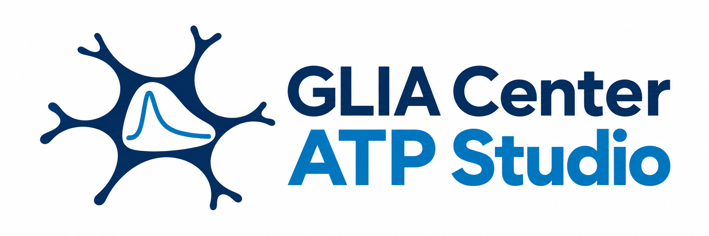

# GLIA Center ATP Studio

  

**OIRからATP活動の確認・定量まで / From OIR to reviewed ATP activity**

**山梨大学・[山梨GLIAセンター](https://glia.yamanashi.ac.jp/)のメンバー向けに開発した解析アプリです。**

**Developed for members of the [Yamanashi GLIA Center](https://glia.yamanashi.ac.jp/) at the University of Yamanashi.**

Windows向けのデスクトップ解析アプリです。OIRの時空間情報を読み込み、[AQuA2](https://github.com/yu-lab-vt/AQuA2)で活動イベントを検出し、ユーザーが採用したROAの特徴量を出力します。画面とマニュアルは日本語・英語併記です。

A desktop analysis app for Windows. Read OIR spatial and temporal metadata, detect activity events with [AQuA2](https://github.com/yu-lab-vt/AQuA2), review ROAs, and export measurements for the events you select. The interface and manual use Japanese and English.

## ダウンロードと起動 / Download and start

[Windowsアプリ / Windows app](https://github.com/NeuroMDPhD/GLIA-Center-ATP-Studio/releases/download/v0.4.1/GLIA-Center-ATP-Studio-Windows-x64.zip) · [マニュアルZIP / Manual ZIP](https://github.com/NeuroMDPhD/GLIA-Center-ATP-Studio/releases/download/v0.4.1/GLIA-Center-ATP-Studio-Manual-JA-EN.zip) · [Releases](https://github.com/NeuroMDPhD/GLIA-Center-ATP-Studio/releases)

1. このリポジトリの **Releases** から `GLIA-Center-ATP-Studio-Windows-x64.zip` をダウンロードします。GitHubの「Source code」ZIPは実行パッケージではありません。 
   Download `GLIA-Center-ATP-Studio-Windows-x64.zip` from this repository’s **Releases**. GitHub’s automatic “Source code” ZIP is not the ready-to-run app.
2. ZIPを右クリックして「すべて展開」を選び、展開先に短いパス（例：`C:\GLIA`）を指定します。展開された`GLIA-ATP`フォルダー内の **`GLIA Center ATP Studio.exe`** をダブルクリックします。実行ファイルと同梱フォルダーを一緒に保持してください。 
   Right-click the ZIP, choose **Extract All**, and use a short destination such as `C:\GLIA`. Open the extracted `GLIA-ATP` folder and double-click **`GLIA Center ATP Studio.exe`**. Keep the executable and accompanying folders together.
3. MATLAB・Fiji・Pythonの別途インストールは不要です。解析はローカルで行います。 
   No separate MATLAB, Fiji or Python installation is required. Analysis runs locally.

**展開エラー `0x80010135` / Extraction error:** v0.2.3では未使用のQMLファイルを除外し、ZIP内の最長パスを211文字から130文字に短縮しました。以前の版でエラーが出た場合は、最新版を新しい短い保存先に全て展開してください。途中まで展開したフォルダーへの上書きやファイルのスキップは避けてください。 / v0.2.3 removes unused QML files and reduces the longest ZIP path from 211 to 130 characters. If an earlier version failed, extract the latest version fully into a new short destination; do not merge it into a partial extraction or skip files.

**対象 / Target:** Windows 10/11 x64。研究用プレビューです。Windows実機での起動・全工程検証は未実施です。 / Research preview; native Windows startup and end-to-end execution remain unverified. See [検証状況 / Validation status](docs/VALIDATION.md).

## 更新履歴 / Version history

[各バージョンの詳しい変更内容 / Detailed release notes](docs/RELEASE_NOTES.md)

| Version | 更新内容 / Changes |
|---|---|
| Unreleased | リポジトリにプロジェクトロゴを追加。 / Added the project logo to the repository. |
| [v0.4.1](https://github.com/NeuroMDPhD/GLIA-Center-ATP-Studio/releases/tag/v0.4.1) | 小さい画面で提案値・説明・ボタンが重なる問題を修正。 / Fix overlapping values, explanations and buttons on small screens. |
| [v0.4.0](https://github.com/NeuroMDPhD/GLIA-Center-ATP-Studio/releases/tag/v0.4.0) | 厳しめの検出初期値、問題別の調整提案、範囲・影響の説明、Python終了時の修正。 / Stricter defaults, problem-led recommendations, parameter ranges/effects and a Python shutdown fix. |
| [v0.3.0](https://github.com/NeuroMDPhD/GLIA-Center-ATP-Studio/releases/tag/v0.3.0) | Professorの処理中アニメーション、状態・経過時間の表示。 / Professor animation with processing status and elapsed time. |
| [v0.2.3](https://github.com/NeuroMDPhD/GLIA-Center-ATP-Studio/releases/tag/v0.2.3) | Windows展開エラー0x80010135に対応。 / Fix Windows extraction error 0x80010135. |
| [v0.2.2](https://github.com/NeuroMDPhD/GLIA-Center-ATP-Studio/releases/tag/v0.2.2) | 制作者・問い合わせ先の表示を統一。 / Consistent creator and contact information. |
| [v0.2.1](https://github.com/NeuroMDPhD/GLIA-Center-ATP-Studio/releases/tag/v0.2.1) | MP4・TIFF・CSV・PNGの個別選択と、OIRフォルダーへの保存。 / Independent MP4/TIFF/CSV/PNG selection and saving beside the OIR. |
| [v0.2.0](https://github.com/NeuroMDPhD/GLIA-Center-ATP-Studio/releases/tag/v0.2.0) | 全視野と拡大像、ROA確認の提案、Shift選択、キーボード採否、Undo。 / Full-field and close-up views, review suggestions, Shift selection, keyboard decisions and undo. |
| [v0.1.0](https://github.com/NeuroMDPhD/GLIA-Center-ATP-Studio/releases/tag/v0.1.0) | OIR読込からAQuA2検出、ROA確認、定量結果出力までの初回公開。 / First release: OIR import, AQuA2 detection, ROA review and quantitative export. |

## マニュアル / Manual

- [日本語・英語マニュアル / Japanese–English manual](docs/USER_GUIDE.md)
- [HTML版 / HTML version](docs/user-guide.html) — ダウンロードしてブラウザーで開けます。アプリのHelpからも開けます。 / Download and open in a browser, or use Help in the app.
- [開発用セットアップ / Developer setup](docs/DEVELOPMENT.md)
- [ライセンス・外部コンポーネント / Licenses and third-party components](THIRD_PARTY_NOTICES.txt)

## 解析の流れ / Workflow

**OIR選択 → 時空間設定 → MP4・PNG・TIFF・CSV → AQuA2 → ROA確認 → 採用結果の出力**

**Choose OIR → Check calibration → MP4 / PNG / TIFF / CSV → AQuA2 → Review ROAs → Export selected results**

- OIRのフレーム間隔と画素サイズを読み込み、手動修正できます。 / Read and edit the frame interval and pixel sizes.
- OIR選択時に同じフォルダーを保存先に設定し、MP4・TIFF・CSV・PNGを個別に選択できます。 / Default to the OIR folder and independently select MP4, TIFF, CSV and PNG outputs.
- 実験情報は任意です。「Include experiment」のチェックを外すと省略できます。 / Experiment details are optional; uncheck “Include experiment” to omit them.
- 全視野とROA拡大像を同時に表示し、波形下のバーで再生します。 / View the full field and selected ROA side by side; playback is below the trace.
- 根拠付きの信号候補・要確認・ノイズ疑いの提案を表示します。最終判断はユーザーが行います。 / Explainable signal-candidate, check and noise-like suggestions support human review.
- Shiftで範囲選択し、A/Enter（採用）、R/Delete（除外）、H（保留）で一括確認できます。 / Shift-select rows and review them together with A/Enter (Keep), R/Delete (Exclude) or H (Hold).
- 面積、ピーク、持続時間、AUC、FWHM、上昇・下降時間、減衰τなどを出力します。 / Export area, peak, duration, AUC, FWHM, rise/fall times and decay τ.
- 原本を保持し、解析設定と確認履歴を保存します。 / Preserve source files and save analysis settings and review history.

## 対応範囲 / Scope

1回に1チャネル・1Z面の等間隔2D+t動画を解析します。AQuA2検出には正方画素が必要です。動き補正・明示的退色補正・3Dイベント分割・CFUは未実装です。既存MATLAB結果との数値的同等性は保証していません。

Analyze one channel and one Z plane at a time with uniform 2D+t sampling. AQuA2 detection requires square pixels. Motion correction, explicit photobleaching correction, 3D event segmentation and CFU are not implemented. Numerical equivalence to existing MATLAB analyses has not been established.

本リポジトリに実験原本・解析プロジェクト・実データの画面画像は含めません。マニュアルの画面例は説明用です。 / This repository excludes original recordings, analysis projects and screenshots of real research data. Manual screenshots are illustrative.

## 原著ソフトウェアとライセンス / Original software and licenses

活動イベント検出の基盤は、Yu Labと貢献者が開発した **AQuA2 (Activity Quantification and Analysis)** です。本アプリはそのFiji/Java実装を利用し、OIR変換・ROA確認・定量結果の出力を行うGUIを提供します。

Activity-event detection is based on **AQuA2 (Activity Quantification and Analysis)**, developed by Yu Lab and its contributors. This app uses its Fiji/Java implementation and provides a GUI for OIR conversion, ROA review and quantitative export.

- [AQuA2 — 原著プロジェクト / Original project](https://github.com/yu-lab-vt/AQuA2)
- [AQuA2-Fiji — 本アプリで使用する実装 / Implementation used by this app](https://github.com/yu-lab-vt/AQuA2-Fiji)
- [AQuA2の引用情報 / AQuA2 citation information](https://github.com/yu-lab-vt/AQuA2#reference)

[AQuA2-Fiji](https://github.com/yu-lab-vt/AQuA2-Fiji) と [Bio-Formats](https://www.openmicroscopy.org/bio-formats/) を使用します。アプリのソフトウェアライセンスは [GPL-3.0](LICENSE) です。外部ライブラリーとGLIAロゴにはそれぞれの権利・ライセンスが適用されます。制作者と問い合わせ先は左下とAboutに表示します。

Uses [AQuA2-Fiji](https://github.com/yu-lab-vt/AQuA2-Fiji) and [Bio-Formats](https://www.openmicroscopy.org/bio-formats/). Application software is licensed under [GPL-3.0](LICENSE). Third-party components and the GLIA logo retain their respective rights and licenses. Creator and contact details appear at the bottom left and in About.

## Reference

Xuelong Mi, Alex Bo-Yuan Chen, Daniela Duarte, Erin Carey, Charlotte R. Taylor, Philipp N. Braaker, Mark Bright, Rafael G. Almeida, Jing-Xuan Lim, Virginia M. Rutten, Wei Zheng, Mengfan Wang, Michael E. Reitman, Yizhi Wang, Kira E. Poskanzer, David A. Lyons, Axel Nimmerjahn, Misha B. Ahrens, Guoqiang Yu, *Fast, Accurate, and Versatile Data Analysis Platform for the Quantification of Molecular Spatiotemporal Signals*, BioRxiv 592259; doi: [https://doi.org/10.1101/2024.05.02.592259](https://doi.org/10.1101/2024.05.02.592259).
