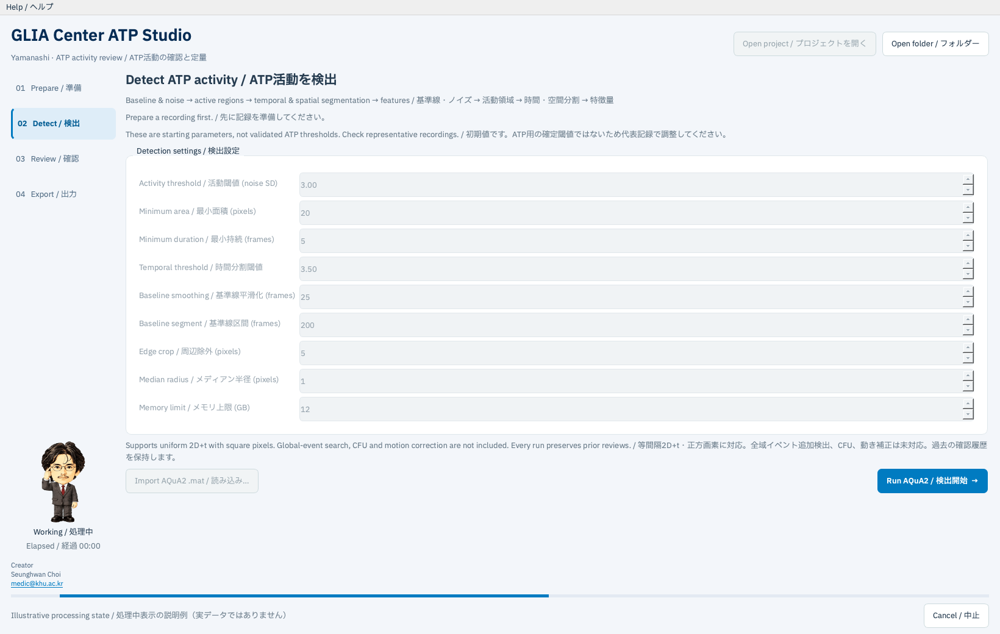
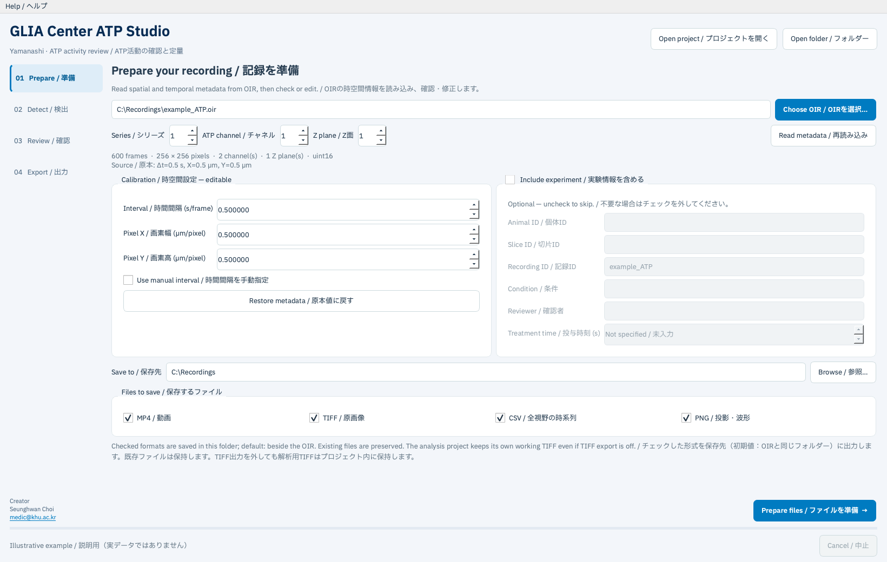
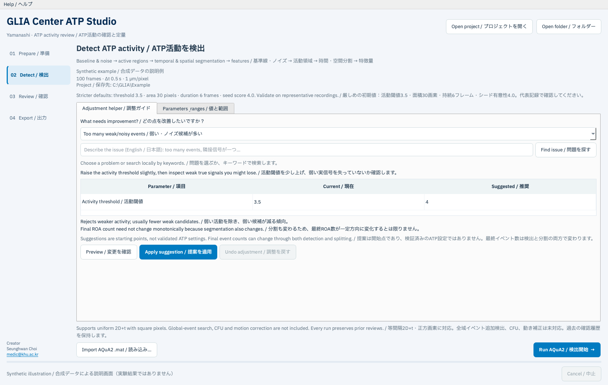
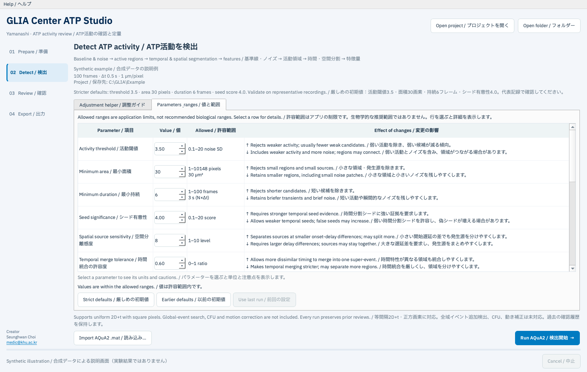
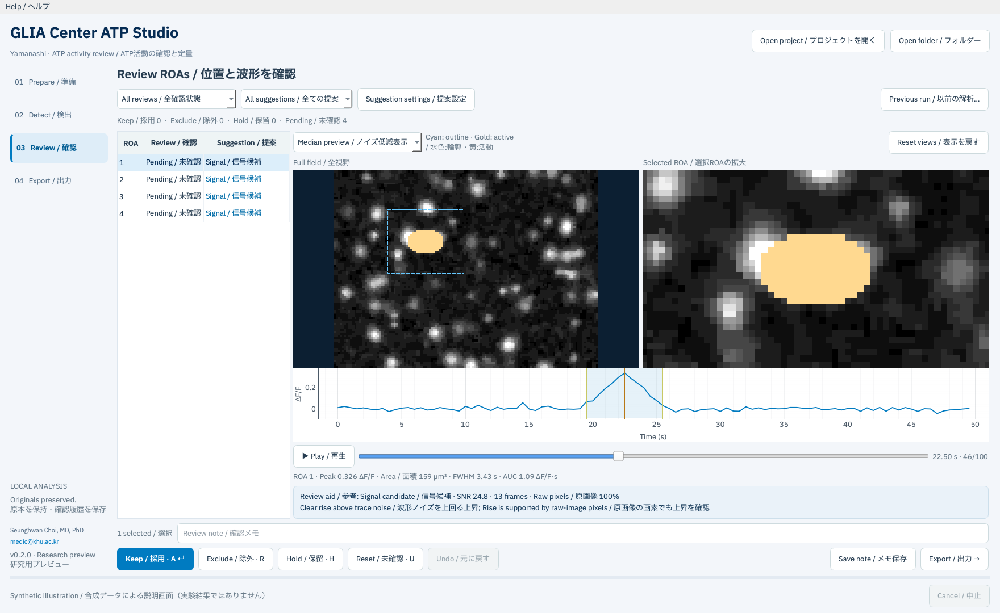

# GLIA Center ATP Studio 操作マニュアル / User manual

日本語・英語併記 · バージョン 0.4.1 · 研究用プレビュー 
Japanese–English · Version 0.4.1 · Research preview

## 1. はじめに / Before you begin

GLIA Center ATP Studioは、OIR動画からAQuA2で活動イベントを検出し、人が確認したROAだけを定量・出力するアプリです。ROAは時空間的な活動イベントを表し、1つの細胞や1匹の動物と同じ単位ではありません。

GLIA Center ATP Studio detects activity events in OIR movies with AQuA2, lets you review individual ROAs, and exports measurements for the ROAs you keep. An ROA is a spatiotemporal activity event; it is not necessarily one cell or one animal.

処理の流れは **準備 → 検出 → 確認 → 出力** です。原本OIRを上書きせず、新しいプロジェクトフォルダーに保存します。解析中にインターネットへのデータ送信は行いません。

The workflow is **Prepare → Detect → Review → Export**. Outputs go into a new project folder; the original OIR is not overwritten. Analysis does not upload recordings to the internet.

## 2. ダウンロードと起動 / Download and launch

1. GitHubの **[Releases](https://github.com/NeuroMDPhD/GLIA-Center-ATP-Studio/releases)** から `GLIA-Center-ATP-Studio-Windows-x64.zip` をダウンロードします。 
   Download `GLIA-Center-ATP-Studio-Windows-x64.zip` from **[Releases](https://github.com/NeuroMDPhD/GLIA-Center-ATP-Studio/releases)** on GitHub.
2. ZIPを右クリックし、**すべて展開**を選びます。展開先は短いパス（例：`C:\GLIA`）を指定します。 
   Right-click the ZIP and choose **Extract All**. Use a short destination such as `C:\GLIA`.
3. 展開された`GLIA-ATP`フォルダー内のGLIAロゴ付き **`GLIA Center ATP Studio.exe`** をダブルクリックします。例：`C:\GLIA\GLIA-ATP\GLIA Center ATP Studio.exe`。 
   Open the extracted `GLIA-ATP` folder and double-click **`GLIA Center ATP Studio.exe`** with the GLIA logo, for example `C:\GLIA\GLIA-ATP\GLIA Center ATP Studio.exe`.
4. 実行ファイルだけを移動せず、`python`、`runtime`、`assets`などの同梱フォルダーを一緒に保持します。 
   Keep accompanying folders such as `python`, `runtime` and `assets` together with the executable.

MATLAB・Fiji・Python・Javaの別途インストールは不要です。通常の利用でコマンド入力は必要ありません。GitHubの自動生成「Source code」ZIPは開発者用で、実行環境を含みません。

No separate MATLAB, Fiji, Python or Java installation is required. Normal use needs no commands. GitHub’s automatically generated “Source code” ZIP is for developers and does not include the runtime.

対象は **Windows 10/11 x64** です。Windows ARM64は検証対象に含みません。512×512画素・720フレーム程度では32 GB RAMを目安にし、検出時のメモリ上限は使用可能なRAMより低くします。Windows実機での起動・全工程検証は未実施です。[検証状況](VALIDATION.md)を確認してください。

The target is **Windows 10/11 x64**. Windows ARM64 is outside the tested scope. For recordings near 512×512 pixels and 720 frames, 32 GB RAM is a practical starting point; set the detection memory limit below available RAM. Native Windows startup and end-to-end verification remain pending. See [Validation status](VALIDATION.md).

## 3. 最短手順 / Quick start

| 手順 / Step | 操作 / Action |
|---|---|
| 01 Prepare / 準備 | `Choose OIR`で原本を選び、時間間隔と画素サイズを確認します。 / Choose an OIR and check the interval and pixel sizes. |
| Experiment / 実験情報 | 不要なら`Include experiment`のチェックを外します。 / Uncheck `Include experiment` if you do not want these details. |
| Prepare files / ファイルを準備 | OIRと同じフォルダーが初期保存先です。必要な形式をチェックし、準備を開始します。 / The OIR folder is selected by default. Check the formats you want, then prepare. |
| 02 Detect / 検出 | 設定を確認し、`Run AQuA2`を押します。 / Check settings and select `Run AQuA2`. |
| 03 Review / 確認 | 各ROAの位置と波形を見て、Keep・Exclude・Holdを選択します。 / Inspect each ROA’s location and trace; choose Keep, Exclude or Hold. |
| 04 Export / 出力 | `Export selection`で採用ROAの結果を保存します。 / Select `Export selection` to save the kept ROAs. |

### Professorの処理中表示 / Professor activity indicator

メタデータ読込、ファイル変換、AQuA2検出、提案計算、結果出力などの処理中は、左下にProfessorのアニメーションと`Working / 処理中`、経過時間が表示されます。操作は不要です。これは処理中であることを示す表示で、残り時間や進捗率の推定ではありません。

While metadata reading, conversion, AQuA2 detection, suggestion calculation or export runs, Professor animates at the bottom left with `Working / 処理中` and elapsed time. No action is needed. The animation indicates an active task; it does not estimate the remaining time or completion percentage.

`Cancel / 中止`を押すと`Stopping… / 中止処理中…`に変わり、実際に処理が終了するまで表示を続けます。完了・中止・エラー後はアニメーションを停止して非表示にします。

Selecting `Cancel / 中止` changes the label to `Stopping… / 中止処理中…`; the indicator remains visible until the task actually ends. It stops and disappears after completion, cancellation or an error.

この画面は説明用で、実験データを使用していません。 / This screen is illustrative and uses no experimental data.

## 4. Prepare：ファイルと時空間設定 / File and calibration

上の画面例は説明用で、実験データを含みません。 / The example above is illustrative and contains no experimental data.

### OIRを選ぶ / Choose the OIR

`Choose OIR`で撮影したOIRを選択します。分割されたOIRでは、マスターファイルと連番の補助ファイルを同じフォルダーに置き、マスターを選んでください。ファイルを選ぶと、フレーム数、画像サイズ、チャネル数、Z面数と校正値を読み込みます。

Use `Choose OIR` to select the acquired OIR. For split recordings, keep the master and numbered companion files together and select the master. The app reads frame count, image dimensions, channels, Z planes and calibration.

### Series・Channel・Z planeの意味 / What these selections mean

| 項目 / Field | 意味と選び方 / Meaning and selection |
|---|---|
| **Series / シリーズ** | 1つのOIR内の独立した画像セットです。フレーム番号ではありません。1つしかない場合は1のままにします。 / An independent image set inside an OIR, not a frame number. Leave it at 1 when there is only one. |
| **ATP channel / チャネル** | 分析する蛍光信号です。ATPセンサーが撮影されたチャネルを選びます。チャネル1が常にATPとは限りません。 / The fluorescence signal to analyze. Select the channel used for the ATP sensor; channel 1 is not always ATP. |
| **Z plane / Z面** | 深さ方向の1枚の撮影面です。1面撮影なら1を選択します。このアプリは複数Z面をまとめた3D解析を行いません。 / One imaging plane along depth. Select 1 for a single-plane recording. This app does not combine Z planes into a 3D analysis. |

例えば、720フレームの単一ATPチャネル・単一Z面動画が1セットなら、通常はSeries 1 / Channel 1 / Z plane 1です。複数チャネルでは撮影設定と照合してください。Series・Channel・Z planeを変更したら、**Read metadata / 再読み込み**を押します。

For example, one 720-frame movie with a single ATP channel and one Z plane normally uses Series 1 / Channel 1 / Z plane 1. For multiple channels, check the acquisition settings. After changing any of these selections, press **Read metadata**.

### Calibration / 時空間設定

| 項目 / Field | 単位 / Unit | 確認内容 / What to check |
|---|---|---|
| Interval / 時間間隔 | s/frame | 1フレーム取得にかかる秒数。1 Hzなら1秒、2 Hzなら0.5秒です。 / Seconds between frames: 1 Hz means 1 s; 2 Hz means 0.5 s. |
| Pixel X / 画素幅 | µm/pixel | 横方向の1画素の長さです。 / Physical width of one pixel. |
| Pixel Y / 画素高 | µm/pixel | 縦方向の1画素の長さです。 / Physical height of one pixel. |

OIRに値があれば自動入力します。欠損値は0で表示され、正しい正の値を入力するまで先に進めません。撮影装置の記録と照合してください。時間間隔を編集すると`Use manual interval`が有効になり、指定した等間隔の時間軸を使います。元の値に戻すには`Restore metadata`を押します。

Values are filled automatically when available in the OIR. Missing values appear as 0; enter correct positive values before continuing. Check them against acquisition records. Editing the interval enables `Use manual interval` and applies a fixed time step. Use `Restore metadata` to restore the source values.

画素サイズは面積、時間間隔は持続時間・AUC・時間関連の値に影響します。単位を確認し、校正値を変更した解析は新しいプロジェクトとして準備してください。

Pixel sizes affect area; the frame interval affects durations, AUC and timing measurements. Check units carefully and prepare a new project when changing calibration for analysis.

### Experiment情報は任意 / Experiment details are optional

`Include experiment / 実験情報を含める`にチェックを入れると、Animal ID、Slice ID、Recording ID、Condition、Reviewer、Treatment timeを記入できます。必要な項目だけ記入し、不明な情報を推測で埋めないでください。

When `Include experiment` is checked, you can enter Animal ID, Slice ID, Recording ID, Condition, Reviewer and Treatment time. Fill only what you know; do not guess missing information.

不要な場合はチェックを外してください。入力欄が無効になり、その状態で新しく準備したプロジェクトと結果表にはこれらの情報を含めません。Treatment timeは**記録開始からの秒数**で、不明なら`Not specified`のままにします。解析元のファイル名・校正値・設定は追跡のため保存されます。

Uncheck it to skip these details. The fields become disabled, and a newly prepared project and its output tables omit them. Treatment time is **seconds from recording start**; leave it `Not specified` if unknown. Source filename, calibration and analysis settings are still retained for traceability.

### 保存先と変換 / Output location and conversion

OIRを選択すると、`Save to`は自動的に**OIRと同じフォルダー**になります。`Browse`で別の保存先を指定することもできます。別のOIRを選ぶと、そのOIRのフォルダーに更新します。メタデータの再読み込みでは、手動指定した保存先を保持します。

Choosing an OIR automatically sets `Save to` to **the folder containing that OIR**. Use `Browse` for another destination. Choosing a different OIR updates the destination to its folder; rereading metadata preserves your chosen destination.

`Files to save`で **MP4・TIFF・CSV・PNGを個別にチェック**します。初期状態では全て選択されています。不要な形式は外してください。`Prepare files`を押すと、選んだ形式だけを指定フォルダーに保存します。PNGを選びCSVを外した場合も、投影画像と波形画像を作成できます。

In `Files to save`, **check MP4, TIFF, CSV and PNG independently**. All start checked; uncheck unwanted formats. Press `Prepare files` to save only the selected formats into the destination folder. PNG projections and a trace image can be generated even when CSV is unchecked.

| チェック / Selection | 出力 / Output |
|---|---|
| MP4 / 動画 | `…_preview.mp4`：選択チャネル・Z面のプレビュー / Preview for the selected channel and Z plane |
| TIFF / 原画像 | `….ome.tif`：原画素値と適用した時空間校正 / Source pixels and applied spatial/temporal calibration |
| CSV / 全視野の時系列 | `…_fov_trace.csv`：フレーム番号、取得時刻、視野全体の平均蛍光 / Frame number, acquisition time and whole-field mean fluorescence |
| PNG / 投影・波形 | `…_mean_projection.png`、`…_max_projection.png`、`…_fov_trace.png`：平均投影・最大投影・全視野波形 / Mean projection, maximum projection and whole-field trace |

出力名には元ファイル名、実行ごとの識別子、シリーズ・チャネル・Z面を含めます。原本や既存の出力を上書きしません。同じ記録を再変換すると、別の名前で保存します。

Output names include the source stem, a unique preparation identifier, and series/channel/Z indices. Originals and existing outputs are preserved; repeating preparation creates different names.

**解析プロジェクトも同じ保存先に新しく作成します。** `project.json`に原本情報・校正・選択形式・出力名・チェックサムを記録します。内部の `raw/movie.ome.tif` と `raw/time_s.npy` は検出・確認・定量に必要な作業データです。**TIFF出力を外しても、この内部TIFFは保持されます。** 外部出力を全部外しても解析できます。外部のMP4やPNGを移動しても、内部データが揃っていればプロジェクトを再開できます。

**A new analysis project is created in the same destination.** Its `project.json` records source information, calibration, selected formats, output names and checksums. Internal `raw/movie.ome.tif` and `raw/time_s.npy` are working data for detection, review and measurement. **Unchecking TIFF suppresses the external TIFF copy; the internal working TIFF remains.** You can uncheck all external formats and still analyze. Moving external MP4 or PNG files does not prevent reopening a project with intact internal data.

原本に加えて解析用TIFF・選択した外部出力・解析中の一時データを保存できる空き容量を確保してください。TIFF出力を選ぶと解析用とは別のコピーも保存します。

Allow disk space for the original recording, the working TIFF, selected external outputs and temporary analysis data. Selecting TIFF saves an additional copy outside the project.

MP4は15 fpsの表示用動画です。**再生時間は実際の撮影時間と異なる場合があります**。画像内に表示される取得時刻を使い、MP4から蛍光強度を定量しないでください。

MP4 playback is 15 fps. **Playback duration may differ from acquisition duration.** Use the acquisition timestamps shown in the movie; do not measure fluorescence intensity from MP4 pixels.

## 5. Detect：AQuA2による検出 / Detection with AQuA2

準備完了後、`02 Detect`へ進みます。v0.4.0では弱い・小さい・短い候補を減らす方向に初期値を変更しました。変更は次回の検出に適用され、既存の結果・採否は書き換えません。

After preparation, open `02 Detect`. Version 0.4.0 starts with stricter settings intended to reduce weak, small and brief candidates. Changes affect the next detection run; existing results and reviews are preserved.

| 設定 / Setting | 以前 / Earlier | 新しい初期値 / New default |
|---|---|---|
| Activity threshold / 活動閾値 | 3.0 noise SD | **3.5 noise SD** |
| Minimum area / 最小面積 | 20 pixels | **30 pixels** |
| Minimum duration / 最小持続 | 5 frames | **6 frames** |
| Seed significance / シード有意性 | 3.5 | **4.0** |

他の初期値は維持しています。初期値・提案は検証済みATP閾値ではありません。弱い実信号も除かれ得るため、代表記録で確認し、群間比較では条件を揃えてください。分割も変わるため、最終ROA数が必ず減るわけではありません。

Other defaults are retained. Defaults and suggestions are not validated ATP thresholds. Weak real signals can be lost: check representative recordings and harmonize settings for group comparisons. Segmentation can also change, so fewer final ROAs are not guaranteed.

### 問題から調整する / Adjust by problem

1. `Adjustment helper / 調整ガイド`で問題を選択します。英語・日本語で入力し、`Find issue / 問題を探す`で検索することもできます。これはローカルのキーワード検索です。複数候補の場合は、意図する問題を選びます。 
   Select a problem, or describe it in English/Japanese and use `Find issue`. This is a local keyword search. Choose the intended problem when several match.
2. 現在値→提案値、期待される影響と注意点を確認します。表示だけでは値は変わりません。 
   Check the current → suggested value, expected effect and caution. Previewing does not change settings.
3. `Apply suggestion / 提案を適用`を押し、`Run AQuA2`で再検出します。同じ信号・ノイズ領域で比較してください。 
   Select `Apply suggestion`, then `Run AQuA2`. Compare the same signals and noise regions.
4. `Undo adjustment / 調整を戻す`は直前の適用を戻します。手動変更後は新しい値を保護するためUndoを無効にします。 
   `Undo adjustment` restores the last applied adjustment. It is disabled after manual edits to protect the newer values.

| 問題 / Problem | 一回の提案 / One suggested adjustment |
|---|---|
| 弱い・ノイズ候補が多い / Too many weak or noisy events | 活動閾値 +0.5 / Activity threshold +0.5 |
| 弱い信号を見逃す / Weak signals missed | 活動閾値 −0.5 / Activity threshold −0.5 |
| 微小領域が多い / Too many tiny regions | 最小面積 ×1.25、切り上げ / Minimum area ×1.25, rounded up |
| 短い点滅が多い / Brief flashes dominate | 最小持続 +1 frame / Minimum duration +1 frame |
| 短い実信号を見逃す / Short real signals missed | 最小持続 −1 frame / Minimum duration −1 frame |
| 隣接発生源が一つになる / Neighboring sources merge | 空間分離感度 +1 / Spatial source sensitivity +1 |
| 一つの活動が細分化される / One spatial event is fragmented | 空間分離感度 −1 / Spatial source sensitivity −1 |
| 時間特性の異なる活動が統合 / Different time courses merge | 時間統合の許容度 −0.1 / Temporal merge tolerance −0.1 |
| 似た時間波形が分離したまま / Similar time courses stay split | 時間統合の許容度 +0.1 / Temporal merge tolerance +0.1 |
| 画像周辺のアーティファクト / Border artifacts | 周辺除外 +1 pixel / Edge crop +1 pixel |

一度に一つの値を小幅に調整し、許容範囲の端では追加変更しません。退色・ドリフト、動き、メモリ問題には一律の数値変更を提案せず、確認事項を表示します。動画を自動判定した提案ではなく、選択した問題に対する規則です。適用後に値を変えず検出した場合、規則版・問題・変更前後をrunの`settings.json`へ記録します。

The helper proposes one small change at a time and stops at allowed limits. Bleaching/drift, motion and memory issues show checks instead of a universal numeric fix. Recommendations follow the selected problem; they do not automatically diagnose the movie. If the applied settings remain unchanged when detection starts, the run's `settings.json` records the rule version, issue and before/after settings.

### 値・範囲・影響 / Values, ranges and effects

`Parameters & ranges / 値と範囲`で直接編集できます。行を選ぶと注意点が表示されます。下記はアプリが許可する範囲で、生物学的な推奨範囲ではありません。画面では記録に合わせた上限と秒・µm²への換算も表示します。

Edit values directly in `Parameters & ranges`; select a row for cautions. These are application limits, not recommended biological ranges. The screen shows recording-specific limits and conversions to seconds and µm².

| 設定 / Setting | 初期値 / Default | 許容範囲 / Allowed range | 増減の影響 / Effects |
|---|---|---|---|
| Activity threshold / 活動閾値 | 3.5 | 0.1–20 noise SD | ↑ Rejects weaker activity; usually fewer weak candidates. / 弱い活動を除き、弱い候補が減る傾向。 ↓ Includes weaker activity and more noise; regions may connect. / 弱い活動とノイズを含み、領域がつながる場合があります。 |
| Minimum area / 最小面積 | 30 | 1–100000 pixels | ↑ Rejects small regions and small sources. / 小さな領域・発生源を除きます。 ↓ Retains smaller regions, including small noise patches. / 小さな領域と小さいノイズを残しやすくします。 |
| Minimum duration / 最小持続 | 6 | 1–10000 frames | ↑ Rejects shorter candidates. / 短い候補を除きます。 ↓ Retains briefer transients and brief noise. / 短い活動や瞬間的なノイズを残しやすくします。 |
| Seed significance / シード有意性 | 4 | 0.1–20 score | ↑ Requires stronger temporal seed evidence. / 時間分割シードに強い証拠を要求します。 ↓ Allows weaker temporal seeds; false seeds may increase. / 弱い時間分割シードを許容し、偽シードが増える場合があります。 |
| Spatial source sensitivity / 空間分離感度 | 8 | 1–10 level | ↑ Separates sources at smaller onset-delay differences; may split more. / 小さい開始遅延の差でも発生源を分けやすくします。 ↓ Requires larger delay differences; sources may stay together. / 大きな遅延差を要求し、発生源をまとめやすくします。 |
| Temporal merge tolerance / 時間統合の許容度 | 0.6 | 0–1 ratio | ↑ Allows more dissimilar timing to merge into one super-event. / 時間特性が異なる領域も統合しやすくします。 ↓ Makes temporal merging stricter; may separate more regions. / 時間統合を厳しくし、領域を分けやすくします。 |
| Minimum source fraction / 最小発生源比率 | 0.01 | 0–1 fraction | ↑ Rejects small source seeds within a super-event; may split less. / 大領域内の小さな発生源を除き、分離を抑える場合があります。 ↓ Allows smaller source seeds; may split more. / 小さな発生源を許容し、分離を増やす場合があります。 |
| Gaussian smoothing / ガウス平滑化 | 0.5 | 0–5 sigma pixels | ↑ Smooths spatial noise more, but can blur neighboring signals. / 空間ノイズを抑えますが、隣接信号をぼかす場合があります。 ↓ Preserves spatial detail and more noise. / 空間的な細部とノイズを残します。 |
| Baseline smoothing / 基準線平滑化 | 25 | 2–1000 frames | ↑ Uses a smoother baseline estimate with less rapid variation. / 基準線を滑らかにし、速い変動を抑えます。 ↓ Lets the baseline estimate follow faster fluctuations. / 基準線を速い変動に追従しやすくします。 |
| Baseline segment / 基準線区間 | 200 | 10–9999 frames | ↑ Finds baseline minima over a longer interval; adapts less locally. / 長い区間で基準線の最小値を探し、局所変動への追従を抑えます。 ↓ Follows local drift more, but may absorb sustained signals. / 局所的なドリフトに追従しますが、持続信号を基準線に含む場合があります。 |
| Edge crop / 周辺除外 | 5 | 0–100 pixels per edge | ↑ Excludes a wider border and any real events there. / 広い周辺を除外し、そこにある実信号も除きます。 ↓ Includes more of the image edge and its artifacts. / 周辺の画素とアーティファクトを含めます。 |
| Median radius / メディアン半径 | 1 | 0–5 pixels | ↑ Suppresses isolated pixels more, but may erase tiny real events. / 孤立画素を抑えますが、小さい実信号も消す場合があります。 ↓ Preserves smaller features and more pixel noise. / 小さな構造と画素ノイズを残します。 |
| Memory limit / メモリ上限 | 12 | 2–64 GB | ↑ Allows a larger Java heap if enough RAM is available. / 空きRAMがあればJavaのヒープを大きくできます。 ↓ Leaves more RAM for the system but can cause Java memory errors. / システムにRAMを残しますが、Javaのメモリ不足が起こり得ます。 |

持続・平滑化窓の上限は記録フレーム数でも制限します。面積の上限は切り出し後の視野、周辺除外の上限は画像寸法に依存します。基準線区間は記録長に切り詰めて使用します。秒換算はN×Δtです。最小持続は候補の時間幅の判定であり、連続した明るいフレーム数ではありません。時間統合の許容度は正規化した波形タイミングの非類似度で、秒ではありません。

Duration and smoothing windows are also limited by the frame count. Maximum area depends on the cropped field, and the edge margin depends on image dimensions. AQuA2 clips the baseline segment to the recording length. Seconds use N×Δt. Minimum duration tests candidate time span, not a required count of continuously bright frames. Temporal merge tolerance is normalized time-course dissimilarity, not seconds.

`Strict defaults / 厳しめの初期値`はv0.4.0の初期値、`Earlier defaults / 以前の初期値`は以前の開始値に戻します。`Use last run / 前回の設定`は開いたrunに保存された設定を明示的に読み込みます。以前の設定が範囲外の場合は理由を表示し、黙って切り詰めません。

`Strict defaults` restores the v0.4.0 starting values; `Earlier defaults` restores the earlier preset. `Use last run` explicitly loads settings recorded in the opened run. Out-of-range older settings show an explanation instead of being silently clipped.

変更方向は同梱AQuA2-Fijiの実装を確認しています。変更量は本アプリの調整用規則です。 / Directions were checked against the bundled AQuA2-Fiji implementation; adjustment amounts are this app's heuristics:

[活動領域 / Active regions](https://github.com/yu-lab-vt/AQuA2-Fiji/blob/ca807872077a736e906698047bd718ce54754eda/src/main/java/va/vt/cbilAQuA2/run/Step2Helper.java) · [時間分割 / Temporal segmentation](https://github.com/yu-lab-vt/AQuA2-Fiji/blob/ca807872077a736e906698047bd718ce54754eda/src/main/java/va/vt/cbilAQuA2/run/Step3Helper.java) · [空間分割 / Spatial segmentation](https://github.com/yu-lab-vt/AQuA2-Fiji/blob/ca807872077a736e906698047bd718ce54754eda/src/main/java/va/vt/cbilAQuA2/run/Step4Helper.java) · [基準線 / Baseline](https://github.com/yu-lab-vt/AQuA2-Fiji/blob/ca807872077a736e906698047bd718ce54754eda/src/main/java/va/vt/cbilAQuA2/run/Step1Helper.java)

`Run AQuA2`を押すと、基準線・ノイズ推定、活動領域検出、時間分割、空間分割、特徴量抽出を行います。処理時間は記録と設定に依存します。キャンセル後は中止処理が終わるまで待ってください。解析をやり直すと新しいrunが作られ、以前の結果と確認履歴を保持します。

`Run AQuA2` performs baseline/noise estimation, active-region detection, temporal segmentation, spatial segmentation and feature extraction. Runtime depends on the recording and settings. After cancelling, wait for cancellation to finish. Each new run retains earlier results and reviews.

この版は、等間隔の2D+t動画と正方画素に対応します。動き補正・明示的退色補正・追加の全域イベント検出・CFU・手描きマスク・3D分割は未実装です。基準線推定は退色補正と同じ処理ではありません。

This version supports uniformly sampled 2D+t movies and square pixels. Motion correction, explicit photobleaching correction, additional global-event detection, CFU, manually drawn masks and 3D segmentation are not implemented. Baseline estimation is not the same as photobleaching correction.

### 既存MATの読み込み / Importing existing MAT results

`Import AQuA2 .mat`から既存のMATLAB v7.3形式のAQuA2結果を読み込めます。MATLABの起動は不要です。元動画に対応する結果チャネル1または2を指定してください。寸法・校正値とサンプルフレームを照合するため、別記録の結果や照合できない位置補正済み結果は拒否します。以前のfavoriteは★として残り、新しい確認状態はPendingです。

Use `Import AQuA2 .mat` for existing MATLAB v7.3 AQuA2 results without running MATLAB. Select the matching result channel, 1 or 2. The app checks dimensions, calibration and sample frames, rejecting mismatched recordings or registered results whose mapping cannot be verified. Prior favorites appear as ★ and begin with Pending review status.

## 6. Review：ROAを確認・選別する / Review and select ROAs

### 全視野・拡大像・波形 / Full field, close-up and trace

左の一覧でROAを選ぶと、中央に**全視野**、右に**選択ROAの拡大像**を同時に表示します。水色の輪郭はイベント全体の領域、黄色は現在フレームの活動画素です。全視野の点線枠は拡大範囲を示します。`Reset views`で初期表示に戻せます。画像と波形の境界をドラッグすると高さを変更できます。

Select an ROA in the table to show the **full field** and **selected ROA close-up** together. Cyan outlines mark the footprint, gold marks active pixels, and the dashed box locates the close-up in the full field. `Reset views` restores the views. Drag the divider between the images and trace to adjust their heights.

**再生バーは波形の下**にあります。2つの画像、スライダー、時刻、波形の縦線は同じフレームに同期します。画像クリックでも一覧内のROAを選べます。小さい画面ではページをスクロールして下の操作欄に移動できます。

**Playback is below the trace.** Both images, the slider, timestamp and trace cursor show the same frame. Clicking an event in either image selects its row. On smaller screens, scroll the page to reach the controls below.

`Raw`は原画像、`Median preview`は表示用のノイズ低減画像です。切り替えても保存済みの検出結果は変わりません。ROAは細胞数ではなく、時空間的な活動イベントです。

`Raw` displays source images; `Median preview` reduces noise for viewing without changing detection results. ROAs are spatiotemporal events, not cell counts.

### 提案と根拠 / Suggestions and evidence

`Suggestion`列と画像下のパネルに、**Signal candidate / 信号候補、Check / 要確認、Noise-like / ノイズ疑い**を表示します。SNR、連続フレーム数、原画像支持率と判定理由を確認できます。提案フィルターで一覧を絞れます。確認状態のフィルターとは独立して組み合わせられます。

The `Suggestion` column and evidence panel show **Signal candidate, Check or Noise-like**, with SNR, continuous frames, raw-image pixel support and reasons. Use the suggestion filter together with the review-status filter to narrow the list.

**提案は検証済みのATP分類器や確率ではありません。** ATPの同定、動き・ドリフト・重複イベントの完全な除去を保証しません。必ず原画像と波形を見て判断してください。提案は既存の採用・除外・保留やAQuA2のイベントを変更しません。

**These rules are not a validated ATP classifier or probability.** They do not establish ATP identity or guarantee removal of motion, drift or duplicate events. Confirm the source images and trace. Suggestions do not change review decisions or AQuA2 events.

| 初期基準 / Default rule | 内容 / Meaning |
|---|---|
| Signal candidate / 信号候補 | SNR ≥ 5、ピークを支える連続3フレーム以上、原画像支持率 ≥ 35%、下記の注意項目なし。 / SNR ≥ 5, at least 3 supporting consecutive frames, raw pixel support ≥ 35%, and no caution flags below. |
| Noise-like / ノイズ疑い | SNR < 2。自動除外はしません。 / SNR < 2; no automatic exclusion. |
| Check / 要確認 | 中間SNR、短いピーク、低い原画像支持率、分断領域、活動の空白、解析境界、記録端の打切り、推定不能など。 / Intermediate SNR, brief peak, low raw support, fragmentation, intermittent activity, analysis boundary, recording truncation or unavailable estimates. |

SNRは、イベント区間内の最大ΔF/Fから区間外の中央値を引き、区間外の `1.4826 × MAD` で割ります。ノイズ推定からイベント区間と前後2フレームを除外し、12フレーム未満またはノイズ推定が不定なら要確認とします。ピーク周囲で基準線＋2倍ノイズを超える連続フレームを数えます。

SNR is the peak ΔF/F within the event minus the off-event median, divided by off-event `1.4826 × MAD`. The event plus two frames on each side is excluded from noise estimation. Fewer than 12 off-event frames or undefined noise yields Check. Continuous support counts frames around the peak exceeding baseline plus twice the noise.

原画像支持率は、ピーク±1フレームで活動する最大256画素を標本化し、最大40区間外フレームの中央値から2倍の画素ノイズを超えて上昇した割合です。画像座標のクロップ補正を適用します。8近傍の最大連結領域が全領域の50%未満、または検出区間の活動フレーム率が70%未満なら注意項目とします。これらは経験的な補助基準です。

Raw support samples up to 256 pixels active within one frame of the peak. It measures the fraction whose mean peak-neighborhood intensity rises above the median of up to 40 off-event frames by twice the per-pixel robust noise. Source-coordinate crop offsets are applied. A largest 8-connected component below 50% of the footprint or active-frame occupancy below 70% adds a caution flag. These are heuristic review aids.

`Suggestion settings`でSNR、連続フレーム数、原画像支持率の基準を変更できます。各解析内に設定・ルール版・入力識別情報・根拠を保存し、出力にも添付します。基準を厳しくしても検出数そのものは変わりません。

Use `Suggestion settings` to adjust SNR, frame support and raw pixel support thresholds. Each run retains settings, rule version, input identifiers and evidence; exports include a snapshot. Stricter suggestion settings do not change the number of detected events.

### キーボードと複数選択 / Keyboard and multiple selection

| 操作 / Action | キー / Key | 結果 / Result |
|---|---|---|
| Keep / 採用 | A / Enter | 選択した全ROAを採用 / Keep all selected ROAs |
| Exclude / 除外 | R / Delete / Backspace | 選択した全ROAを除外 / Exclude all selected ROAs |
| Hold / 保留 | H | 選択した全ROAを保留 / Hold all selected ROAs |
| Reset / 未確認へ | U | 選択した全ROAをPendingに戻す / Reset selected ROAs to Pending |
| Undo / 元に戻す | Ctrl+Z (Windows), Cmd+Z (Mac) | 直前の一括確認またはメモ変更を戻す / Undo the last review batch or note change |
| Play / Pause / 再生・停止 | Space | 同期動画を再生・停止 / Play or pause synchronized views |
| Save note / メモ保存 | ボタン / Button | 採否を変えず選択ROAのメモを保存 / Save notes without changing decisions |

最初の行をクリックし、**Shiftを押しながら最後の行をクリック**すると範囲選択できます。**Ctrl（MacではCmd）＋クリック**で行を個別に追加・解除できます。Shift＋上下キーでも範囲を伸ばせます。画像・波形は選択範囲内の現在行を表示し、採用・除外・保留は選択した全行に適用します。単独選択の採否後は次の行へ進みます。

Click the first row, then **Shift-click the last row** to select a range. **Ctrl-click (Cmd-click on Mac)** adds or removes individual rows. Shift+Up/Down also extends the range. Images and trace preview the current selected row; decisions apply to every selected row. After a single-row decision, the selection advances.

文字入力中は確認ショートカットを無効にします。複数行のメモ欄を編集しなければ各ROAの既存メモを保持します。編集すると共通メモとして選択行に適用します。Undoはこの画面で行った直前の操作のみが対象で、プロジェクトや解析を切り替えるとリセットされます。

Review shortcuts are disabled while typing. If you do not edit the multi-selection note field, each ROA keeps its own note. Editing it applies the shared note to selected rows. Undo restores only the last operation in this view and resets when switching projects or runs.

採否は操作ごとに保存され、確認時刻と一括操作IDを履歴に残します。実験情報が有効なら確認者も記録します。★は過去のfavoriteの印で、自動採用を意味しません。`Previous run`で以前の解析に戻れます。

Each decision is saved immediately, with review time and a batch ID in history. Reviewer is recorded when experiment details are enabled. A ★ marks a prior favorite, not automatic acceptance. Use `Previous run` to reopen earlier analyses.

## 7. Export：採用ROAの結果を保存する / Export selected results

`04 Export`で採用数・保留数・未確認数を確認し、必要なら`Include selected-ROA overlay MP4`を選んで`Export selection`を押します。毎回新しい出力フォルダーを作り、`RESULTS.html`を開きます。**KeepにしたROAだけ**が採用結果に含まれます。

In `04 Export`, check the counts of kept, held and pending events. Optionally select `Include selected-ROA overlay MP4`, then press `Export selection`. Every export creates a new folder and opens `RESULTS.html`. **Only Keep events** enter the selected results.

| ファイル / File | 内容 / Content |
|---|---|
| `selected_events.csv` | 採用ROAの定量値とsuggestion列 / Measurements and suggestion columns for kept ROAs |
| `review_suggestions.json` | 提案基準・版・根拠・入力識別情報 / Suggestion rules, version, evidence and input identifiers |
| `review_all_events.csv` | 全ROAの定量値と確認状態 / Measurements and review states for every ROA |
| `selected_traces.csv` | 採用ROAの全時間ΔF/Fと活動フレーム情報 / Full ΔF/F traces and active-frame flags for kept ROAs |
| `recording_summary.csv` | 記録単位の件数、確認完了状態、採用発生頻度 / Recording-level counts, review completion and accepted onset rate |
| `ROA_XXXX.png`, `selected_traces.png` | 個別・重ね合わせ波形 / Individual and combined traces |
| `selected_ROA_overlay.png`, `.mp4` | 採用ROAの位置と動画 / Map and optional movie of kept ROAs |
| `selected_ROA_masks.tif` | 1ページにつき1イベントの空間マスク / One spatial mask per event per page |
| `mask_page_index.csv` | TIFFページとイベントIDの対応 / TIFF-page to event-ID mapping |
| `selected_events.h5` | 原画像座標の時空間マスクと波形 / Spatiotemporal masks in source-image coordinates and traces |
| `manifest.json` | 原本・設定・選択・出力ファイル識別情報 / Source, settings, selections and output-file identifiers |

0イベント・0採用でも、ヘッダー付きCSVと記録要約を保存できます。採用がない場合、採用ROAの波形画像・マスクTIFF・MP4は作成しません。確認途中の出力も可能ですが、`review_complete`がFalseの場合は保留または未確認が残っています。

Zero detections or zero selected events still produce CSV headers and a recording summary. With no selected events, selected trace plots, mask TIFF and overlay MP4 are not created. Partial review can be exported; `review_complete=False` means held or pending events remain.

CSVはExcelで開きやすいUTF-8 BOM形式で、列名は英語です。測定できない値は0に置換せず空欄にし、`qc_flags`に理由を残します。

CSVs use UTF-8 with a BOM for Excel compatibility and English column names. Unavailable values remain blank, rather than being replaced by zero; reasons appear in `qc_flags`.

## 8. 定量値の読み方 / Interpreting measurements

| 列 / Column | 定義 / Definition |
|---|---|
| `peak_dff`, `peak_time_s` | 検出イベント区間内の元領域ΔF/Fの最大値と時刻 / Maximum original-footprint ΔF/F and its time within the detected event interval |
| `area_um2` | イベント中に活動した全画素の空間和集合×画素幅×画素高 / Union of spatial pixels active during the event × pixel width × pixel height |
| `duration_span_s` | 最後の検出時刻−最初の検出時刻 / Last detected timestamp minus first detected timestamp |
| `active_sample_duration_s` | 活動フレーム数×代表時間間隔 / Number of active frames × median interval |
| `auc_signed_dff_s` | 検出開始〜終了のΔF/Fを台形積分 / Trapezoidal integral of ΔF/F from detected onset to end |
| `auc_positive_dff_s` | 同区間の負値を0にして積分 / Same integral after clipping negative values to zero |
| `fwhm_s` | ゼロ基準ピークの50%交差間隔。AQuA2拡張窓内で線形補間 / Width between nearest 50%-of-peak crossings relative to zero, linearly interpolated within the AQuA2 extended window |
| `rise_10_90_s`, `fall_90_10_s` | ピーク前の10→90%上昇、ピーク後の90→10%下降 / 10→90% rise before the peak and 90→10% fall after it |
| `decay_tau_s`, `decay_fit_r2` | ピーク後の`A exp(-t/τ)+C`適合。6点以上・50%以上の下降・R²≥0.8・τ境界未到達を採用条件とする / Post-peak fit to `A exp(-t/τ)+C`; requires at least 6 points, a 50% fall, R²≥0.8 and no τ bound hit |
| `onset_from_drug_s` | 投与時刻が指定された場合の相対開始時刻 / Onset relative to specified treatment time |
| `centroid_x_source_px`, `centroid_y_source_px` | 原画像上の0始まり重心座標 / Zero-based centroid coordinates in the source image |
| `aqua_*` | AQuA2固有の測定値。上記と定義が異なる場合があります / Native AQuA2 measurements, whose definitions may differ |
| `qc_flags` | 記録端での打切り、境界接触、非有限値、適合不良など / Flags for censoring, boundary contact, nonfinite values or unreliable fitting |

`duration_span_s`と`active_sample_duration_s`は別の定義です。1フレームだけの活動では、前者は0秒でも後者は1フレーム分になります。`aqua_auc_dff_frames`はAQuA2のサンプル和で、秒単位のAUCと混同しないでください。

`duration_span_s` and `active_sample_duration_s` have different definitions. A one-frame event has zero timestamp span but one frame of sample duration. `aqua_auc_dff_frames` is the engine’s sample sum and should not be confused with AUC integrated in seconds.

減衰τは波形を記述する値です。単独でATPの放出・分解・拡散などの機序を確定しません。イベント数は動物数ではなく、群間解析では個体・切片・記録の階層を別途保持してください。実験情報を省略した場合は、対応表を研究者側で管理してください。

Decay τ describes the trace; it does not by itself identify ATP release, breakdown or diffusion mechanisms. Event count is not animal count. Preserve animal, slice and recording hierarchy for group analyses; if you omit experiment details, maintain that mapping separately.

採用発生頻度は、最初から最後のサンプルまでの観測時間に対する採用イベントの開始数です。最初のサンプルから存在するイベントを除外します。採用条件と確認状況に依存し、全ATPイベント頻度を自動的に表すものではありません。

Accepted onset rate counts kept event onsets over the interval from the first to last sample, excluding events already present at the first sample. It depends on selection criteria and review completeness and is not automatically the total ATP event frequency.

## 9. 保存と再開 / Saving and resuming

`Open project`からプロジェクトフォルダー内の`project.json`を選択します。確認状態とメモは操作時に保存されます。プロジェクトを移動するときは、`raw`・`runs`・`exports`などを含むフォルダー全体を移動してください。既存プロジェクトを開いた後にPrepare欄を書き換えても、過去の解析を自動更新しません。変更した校正・実験情報を適用するには新しいプロジェクトを準備します。

Use `Open project` and select `project.json` inside the project folder. Review states and notes are saved when you act. To move a project, move the entire folder including `raw`, `runs` and `exports`. Editing Prepare fields after reopening a project does not automatically update prior analyses. Prepare a new project to apply changed calibration or experiment details.

## 10. よくある問題 / Troubleshooting

| 状況 / Symptom | 対処 / Action |
|---|---|
| 起動しない / App does not open | ZIP全体を展開したか、実行ファイルと同梱フォルダーが一緒か確認します。表示された起動ログの場所を確認します。 / Verify full extraction and keep bundled folders beside the executable. Check the startup-log location shown in any error message. |
| 展開エラー `0x80010135`・パスが長すぎる / Path too long while extracting | v0.2.3以降をダウンロードし、新しい短い展開先（例：`C:\GLIA`）に全て展開します。旧版の途中まで展開したフォルダーと混在させず、ファイルをスキップしないでください。既存の解析プロジェクトは削除せず、起動後に`Open project`で開きます。 / Download v0.2.3 or later and extract fully into a new short destination such as `C:\GLIA`. Do not merge with a partly extracted old version or skip files. Preserve existing analysis projects and reopen them with `Open project`. |
| Interval・Pixelが0 / Calibration is 0 | OIRから取得できていません。撮影記録を確認し正しい値を入力します。 / Metadata was unavailable; enter correct values from acquisition records. |
| 違うチャネルに見える / Wrong channel appears selected | 撮影時のチャネル割り当てを確認し、選択後にRead metadataを押します。 / Check acquisition channel assignments and press Read metadata after changing the selection. |
| 分割OIRを開けない / Split OIR cannot be read | マスターと補助ファイルを同じ場所に置き、マスターを選びます。 / Keep the master and companion files together and select the master. |
| Window exceeds recording length | 基準線平滑化窓と最小持続をフレーム数以下にします。 / Keep the smoothing window and minimum duration within the recording length. |
| Square pixels required | X/Y画素サイズを撮影記録と照合します。解析を通すために値を偽って同じにしないでください。 / Check X/Y calibration against acquisition records; do not falsify values to bypass the requirement. |
| Irregular timestamps | この検出版は等間隔時系列が必要です。手動間隔は実際の取得条件が確認できる場合に使います。 / Detection requires uniform sampling. Use a manual interval only when justified by actual acquisition conditions. |
| メモリ不足・検出停止 / Memory error or stopped detection | 他の大きな処理を閉じ、使用可能RAMとMemory limitを確認します。 / Close other memory-intensive work and check available RAM and Memory limit. |
| 検出が0件 / No events detected | 選択チャネル・信号・設定を確認します。必ずイベントが出るよう閾値を調整するのではなく、代表例で妥当性を確認します。 / Check signal, channel and settings; validate representative examples rather than tuning solely to force events. |
| 採用CSVが空 / Selected CSV has no rows | Keepにしたイベントがあるか確認します。Hold・Pending・★のみでは採用されません。 / Confirm that events are marked Keep; Hold, Pending and ★ alone do not select them. |
| FWHMやτが空欄 / FWHM or τ is blank | `qc_flags`を確認します。観測範囲内に必要な交差がない場合や適合不良では空欄になります。 / Inspect `qc_flags`; missing crossings or unreliable fits leave measurements blank. |
| MATが拒否される / MAT import rejected | 同じ原本・チャネル・校正・前処理の結果か確認します。 / Verify the same source, channel, calibration and compatible preprocessing. |

解析中のログは`Help → Show log`、詳細はプロジェクト内の`logs`および各`runs`内のログで確認できます。起動ログはWindowsでは通常`%LOCALAPPDATA%\GLIA Center ATP Studio\startup.log`に保存します。制作者と問い合わせ先は画面左下と`Help → About`に表示します。

Use `Help → Show log` during analysis. Detailed logs are in the project’s `logs` directory and individual `runs` directories. On Windows, the startup log is normally `%LOCALAPPDATA%\GLIA Center ATP Studio\startup.log`. Creator and contact details appear at the bottom left and in `Help → About`.

## 11. エンジンと再現性 / Engine and reproducibility

検出エンジンは[AQuA2-Fiji](https://github.com/yu-lab-vt/AQuA2-Fiji)の固定コミット`ca807872077a736e906698047bd718ce54754eda`を使用します。OIRはBio-Formats 8.4.0で読み込みます。前処理、エンジン設定、元ファイルの識別情報と確認履歴を保存します。Java版と既存MATLAB解析との数値的同等性は確認していません。異なる前処理やエンジン版のイベント数を、そのまま同じ解析結果として混合しないでください。

Detection uses [AQuA2-Fiji](https://github.com/yu-lab-vt/AQuA2-Fiji) at pinned commit `ca807872077a736e906698047bd718ce54754eda`; OIR reading uses Bio-Formats 8.4.0. Preprocessing, engine settings, source identifiers and review history are saved. Numerical equivalence between this Java pipeline and existing MATLAB analyses has not been established. Do not pool event counts from differing preprocessing or engine versions as if they were identical analyses.

[検証状況 / Validation status](VALIDATION.md) · [外部コンポーネント / Third-party notices](../THIRD_PARTY_NOTICES.txt)
